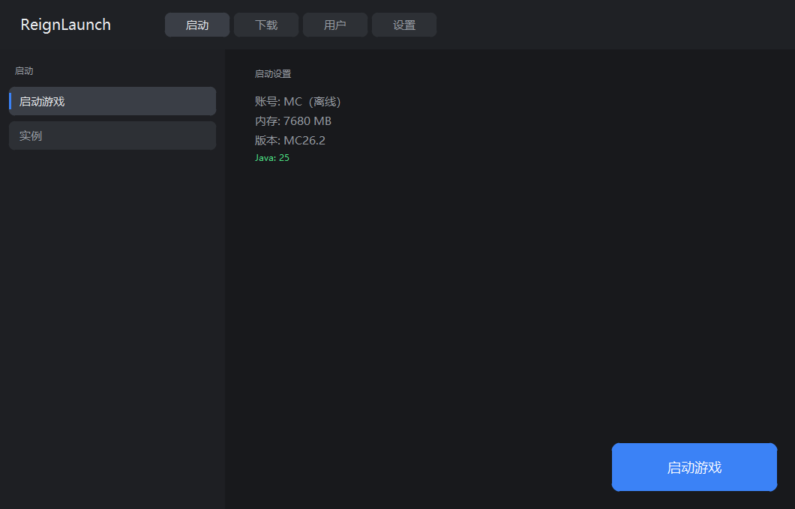
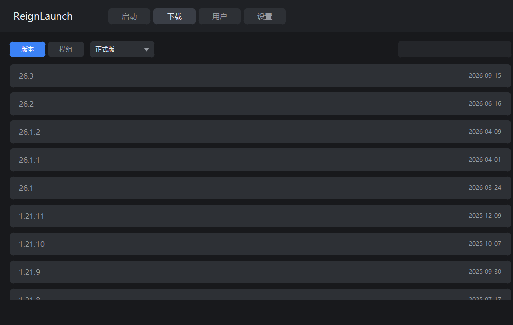
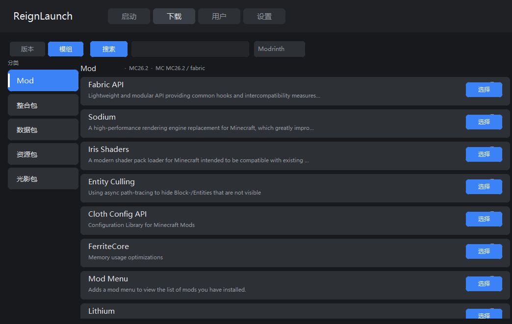
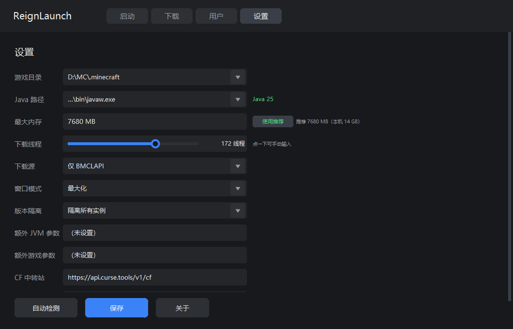
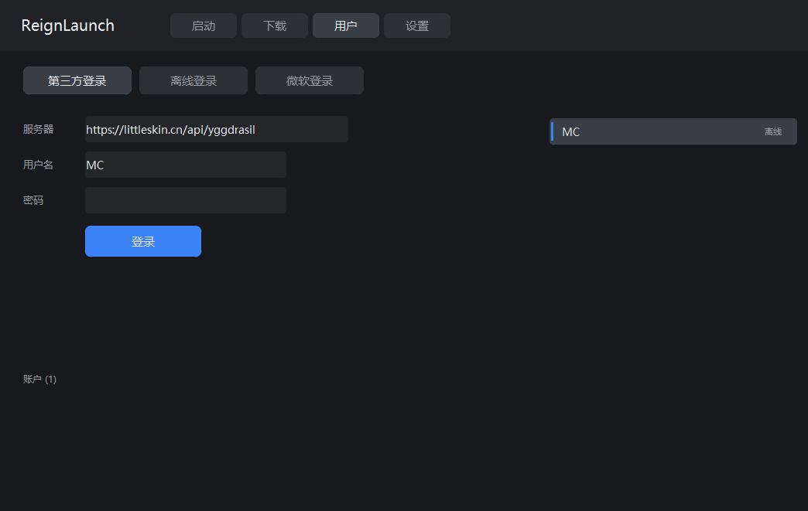
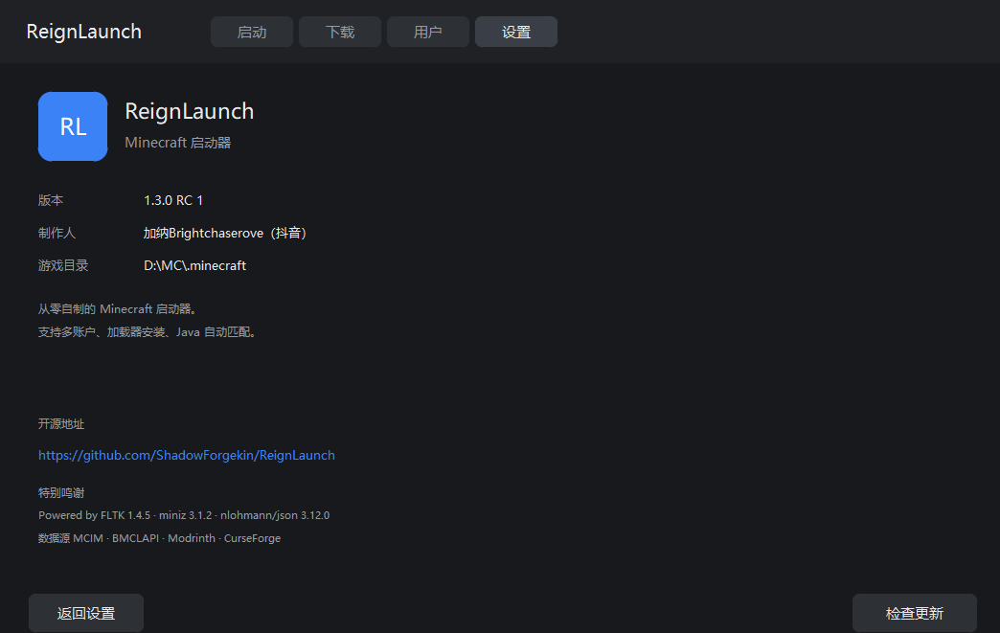

# ReignLaunch

**一个从零手写的 Minecraft 启动器 · FLTK 1.4.5 · 单文件源码**

[](https://www.douyin.com/)
[](https://github.com/ShadowForgekin/ReignLaunch/releases)
[](https://github.com/ShadowForgekin/ReignLaunch)
[](https://www.fltk.org/)
[](LICENSE)

ReignLaunch 是一个完全自制的 Minecraft 启动器，不依赖 Electron、JavaFX 或任何大型运行时。
整个界面由 FLTK 自绘，逻辑层与界面层合并在一个 `.cpp` 文件中，最终产物是 **一个 5.8 MB 的独立 exe**。

---

## 截图

| 启动页 | 版本下载 |
|---|---|
|  |  |

| 模组下载 | 设置 |
|---|---|
|  |  |

| 用户 | 关于 |
|---|---|
|  |  |

---

## 1.3.0 RC 1 更新日志

### 设置页重做

- 改为**纯自绘 UI**，彻底摆脱子控件堆叠导致的卡死
- 设置项从 7 项扩展到 **11 项**：
  - 新增 **额外 JVM 参数** —— 例如 `-XX:+UseG1GC -XX:MaxGCPauseMillis=50`
  - 新增 **额外游戏参数**
  - 新增 **CurseForge 中转站** —— 可自定义镜像地址
  - 新增 **authlib-injector** —— 带「自动检测」按钮，一键定位第三方登录所需的 jar
- 内容超出窗口时支持**滚轮滚动**，行区域自动裁剪，不会盖住底部按钮
- 修复「使用推荐」按钮与推荐值提示文字重叠
- 修复下拉框「要点两次才能展开」、滑条「只能拖一点」、手动输入无响应

### 模组面板

- 新增**左侧分类栏**：Mod / 整合包 / 数据包 / 资源包 / 光影包
  - 通过 Modrinth `project_type` 过滤，选中项蓝底高亮 + 左侧亮条
- 新增**真正的搜索输入框**（可输入、可聚焦），并修复：
  - 查询词未 URL 编码导致中文/空格搜索失败
  - `facets` 参数重复出现，后一个覆盖前一个，导致类型过滤失效
  - 搜索改为**后台线程**，切换标签不再卡顿 2~5 秒
- 新增**模组详情页**：简介、下载量、版本自选列表
- 详情页版本列表改为**后台加载**，点开立即响应，不再冻结界面
- 移除多余的「推荐模组」卡片，直接平铺全部搜索结果

### 下载页

- 恢复**版本类型筛选下拉**：正式版 / 快照版 / 远古版 / 所有版本
- 修复下拉框被版本列表遮挡（绘制顺序问题）
- 修复首次进入页面「必须刷新才显示列表」
- 修复「搜索」按钮与顶部标签重叠

### 交互修复

- **滚轮方向修正**：此前向下滚内容反而向上走（5 处 `event_dy` 符号用反）
- **事件分发修正**：页面重写 `handle()` 后未转交 `Fl_Group::handle`，导致所有输入框无法获得焦点、打不了字
- 修复输入框/按钮位置与点击热区不一致（绘制、点击、控件三处坐标统一）

### 启动与下载

- 启动浮层改为**沉浸式下载视图**：实时速度、已下载字节、文件数、真实进度条
- **取消启动真正生效**：轮询取消标志后调用 `TerminateProcess` 结束游戏进程
- 强制使用 `java.exe` 而非 `javaw.exe`，并以 `CREATE_NO_WINDOW` 启动，不再闪黑框

### 关于页

- 补齐信息：版本号、制作人、游戏目录
- **开源地址可点击**，点击调用 `ShellExecuteW` 打开浏览器
- 新增**特别鸣谢**区块
- 新增**检查更新**按钮：检查到新版本后再点一次即下载替换

### 在线源

- CurseForge 支持**免 API Key 镜像**，自动探测：`api.curse.tools` → `cf.mcim.moe` → `mcim.bangbang93.com`
- 镜像不可用时自动回退到 Modrinth

---

## 功能特性

- **多账户管理**：离线 / 微软正版 / 第三方验证（authlib-injector）
- **版本安装**：Mojang 官方版本清单，支持正式版/快照版/远古版筛选
- **加载器安装**：Fabric / Quilt / Forge / NeoForge / QSL / Fabric API，版本自选
- **模组下载**：Modrinth 与 CurseForge 双源，五大分类，版本自选
- **Java 自动匹配**：按版本需求自动选择/下载合适的 Java
- **BMCLAPI 镜像**：下载源可切换官方/镜像/自动
- **版本隔离**：可为每个实例配置独立 `.minecraft` 目录
- **单文件交付**：一个 exe，无安装、无运行时依赖

---

## 系统要求

- Windows 10 / 11（x64）
- 无需 .NET / Java 运行时（启动器自身用 C++ 编写）
- 运行游戏需要 Java（启动器会自动检测并提示下载）

---

## 构建

```bat
cd src

gcc -O2 -c miniz.c -o miniz.o
windres res.rc -O coff -o res.o

g++ -std=c++17 -O2 -mwindows -static -static-libgcc -static-libstdc++ ^
    -finput-charset=UTF-8 -fexec-charset=UTF-8 -fwide-exec-charset=UTF-16LE ^
    -I. -IFL -o ReignLaunch.exe ReignLaunch.cpp miniz.o res.o ^
    -Wl,--start-group libfltk.a -Wl,--end-group ^
    -lwinhttp -lshell32 -ladvapi32 -lole32 -luuid -lgdi32 -lcomctl32 ^
    -loleaut32 -lshlwapi -lcomdlg32 -lgdiplus -lwinspool -lws2_32
```

需要 MinGW-w64（GCC 13+）与 FLTK 1.4.5 静态库 `libfltk.a`。

---

## 技术栈

| 组件 | 用途 |
|---|---|
| FLTK 1.4.5 | 界面（页面全部自绘） |
| miniz 3.1.2 | zip 解压，替代 `tar.exe` 子进程 |
| nlohmann/json 3.12.0 | JSON 解析 |
| WinHTTP | 全部网络请求 |
| Win32 / GDI | 窗口、图标、字体枚举 |

数据源：**MCIM** · **BMCLAPI** · **Modrinth** · **CurseForge** · **Mojang**

---

## 致谢

Powered by **FLTK** · **miniz** · **nlohmann/json**

感谢 MCIM、BMCLAPI 提供的公共镜像服务。

---

## 许可

[MIT](LICENSE)

作者：**加纳Brightchaserove（抖音）**
