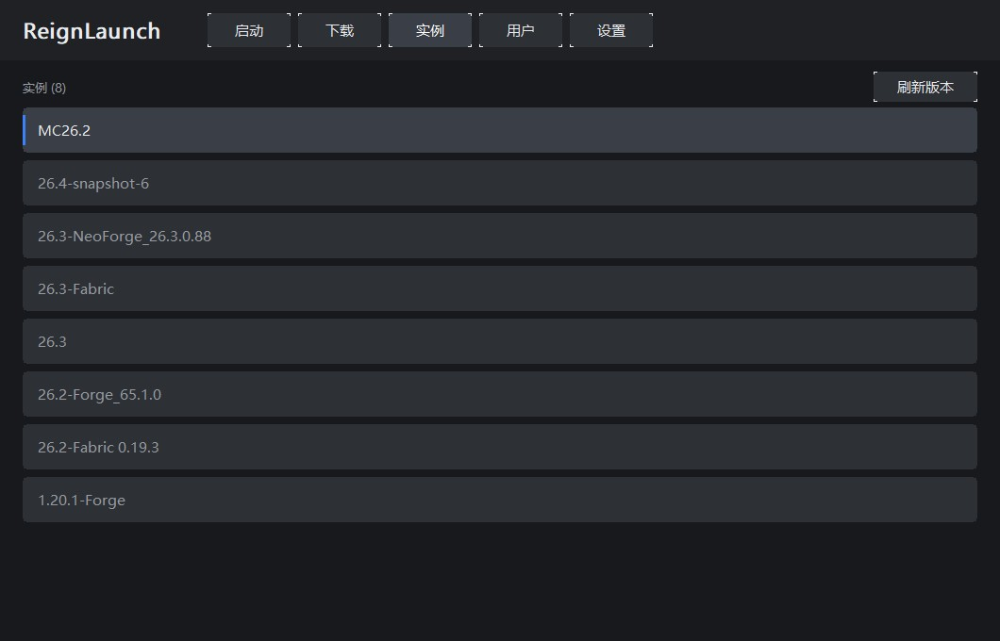
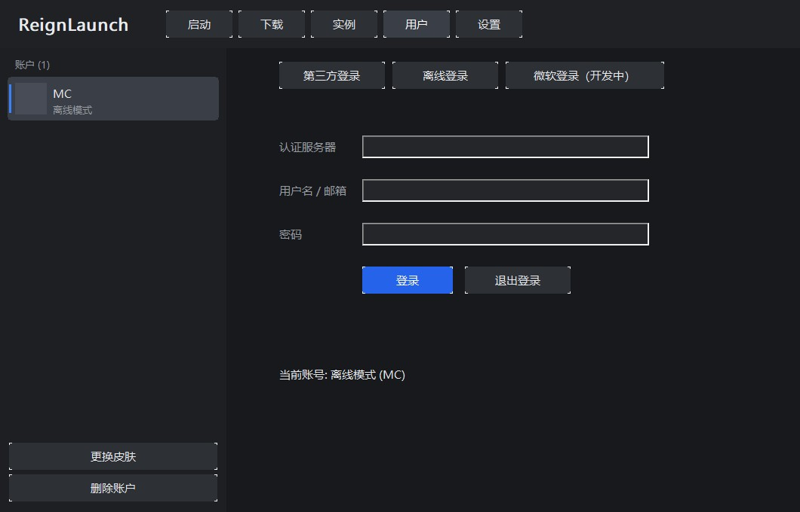
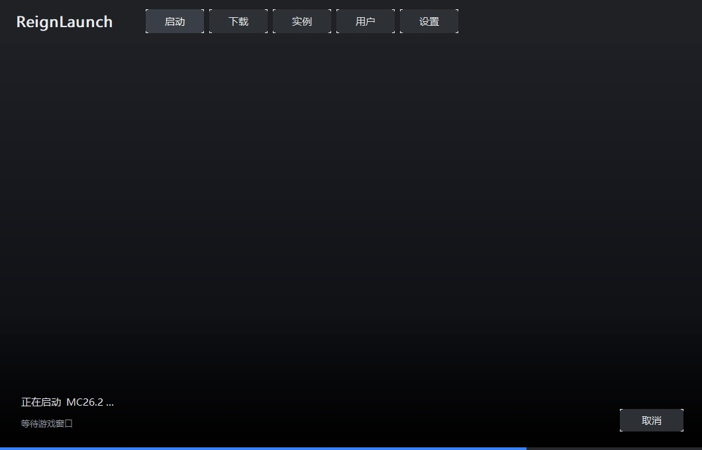

# ReignLaunch

用 **C++17 + Win32 GDI** 从零手写的 Minecraft 启动器，无第三方 UI 框架，单窗口多页面。

**v1.0.0 Beta 3** · 制作人：加纳Brightchaserove（抖音）


---

## 功能

### 页面结构

顶部四个标签：**启动 / 实例 / 用户 / 设置**；「关于」在设置页左侧子菜单里。

| 页面 | 内容 |
|---|---|
| 启动 | 账号 / 内存 / 当前版本，启动游戏按钮 + ▲ 实例选择浮层 |
| 实例 | 整页实例列表，点一行即切换 |
| 用户 | 左侧账户列表（可多个），右侧登录 / 新建离线账户 |
| 设置 | 游戏目录、Java 路径、最大内存、版本隔离、关于 |

### 账户

- **多账户**：可以创建任意多个账户，点左侧卡片切换
  - 离线账户：填名字 → 点「使用离线」即新建；同名则切换
  - 第三方账户：登录成功后自动加入列表
- **离线皮肤**：选 64×64 或 64×32 的 PNG
  - 存一份到 `%APPDATA%\ReignLaunch\skins\<玩家名>.png`（界面头像用）
  - 同时写入 `.minecraft\CustomSkinLoader\LocalSkin\textures\<玩家名>.png`，
    装了 **CustomSkinLoader** 模组就能在游戏里看到
  - 每个账户独立保存自己的皮肤
- **离线 UUID**：`MD5("OfflinePlayer:名字")` + version 3 / variant 位，与官方一致
- **第三方登录**：标准 Yggdrasil（`POST {server}/authserver/authenticate`），
  自动注入 `-javaagent:authlib-injector.jar=<服务器>`（jar 已编译进 exe）

### Java 自动匹配

按版本 JSON 里的 `javaVersion.majorVersion` 选 Java，没有就顺着 `inheritsFrom` 找父版本，
再没有就按 MC 版本号推断（1.20.5+ → 21，1.18–1.20.4 → 17，1.17 → 17，更早 → 8）。

**优先选最贴近的版本**（1.20.1 用 Java 17 而不是 25）。本机找不到时弹窗提示，
可一键打开 Adoptium 下载页。

### 启动流程

点击「启动游戏」后，主窗口内叠一层浮层（不新开窗口、不覆盖顶部标签），显示四步：

1. 检测 Java 版本
2. 处理游戏依赖
3. 登录
4. 等待游戏启动

进度条在补全文件时按 `已下载/总数` 走；**第四步要等游戏窗口真正出现才打勾**，
判定条件是「属于游戏 PID + 窗口可见 + 标题非空」，最多等 180 秒。完成后 1.5 秒自动收起。

### 版本隔离

设置页可选三档，解决 Forge 找不到 mods 的问题：

| 选项 | 行为 |
|---|---|
| 隔离所有实例 | `--gameDir` 指向 `versions/<版本>` |
| 隔离模组实例 | 目录下有 `.jar`，或版本 id / 版本 JSON 含 Forge / Fabric / NeoForge / Quilt 才隔离 |
| 不隔离实例 | 全部用 `.minecraft` 根目录，模组读 `.minecraft\mods` |

### 版本与文件

- **JSON 解析**：`inheritsFrom` 递归合并（libraries 追加、arguments 分段合并）
- **规则判定**：`os.name` / `os.arch` / `features`，正确过滤 macOS 专用参数与 demo 参数
- **classpath**：优先 `downloads.artifact.path`，回退 Maven 坐标推算
- **natives**：老版本 classifier 解压（走系统自带 `tar.exe`）
- **占位符**：`${natives_directory}` / `${classpath}` / `${game_directory}` 等，未解析的自动丢弃
- **启动前自动补全**：扫描 libraries / 客户端 jar / assets，缺文件先下载再启动
- 用 `java.exe` + `CREATE_NO_WINDOW` 启动：不弹黑窗口，但能抓到完整日志

### 下载器

- WinHTTP 实现，无第三方网络库
- SHA1 校验（已有文件损坏会自动重下）
- `.part` 原子写入，断网不留半截文件
- 官方源失败自动切 **BMCLAPI 镜像**

### 界面细节

- 全部自绘（GDI 双缓冲），无原生控件外观
- 所有者绘制按钮，▾ / ▲ 三角形直接画，不依赖字体字形
- 下拉列表用无边框浮层（不进任务栏），点别处或 Esc 关闭
- 日志默认不显示，**只有游戏出错才弹独立错误窗口**（带复制日志按钮）

| 实例 | 用户 |
|---|---|
|  |  |

| 设置 | 关于 |
|---|---|
|  |  |



## 构建

需要 **MinGW-w64 GCC 8+**（在 GCC 16.2.0 上验证），以及 `windres`。

1. 下载 [authlib-injector](https://github.com/yushijinhun/authlib-injector/releases) 的 jar，
   放到 `src/` 并命名为 `authlib-injector.jar`（它会被编译进 exe，不随仓库分发）
2. 编译：

```bat
cd src
windres res.rc -O coff -o res.o
g++ -std=c++17 -O2 -mwindows -static ^
    -finput-charset=UTF-8 -fexec-charset=UTF-8 -fwide-exec-charset=UTF-16LE ^
    -o ReignLaunch.exe ReignLaunch.cpp res.o ^
    -lcomctl32 -lole32 -lshell32 -lgdi32 -luuid -ladvapi32 -lwinhttp -lshlwapi -lcomdlg32 -lgdiplus
```

> `-fwide-exec-charset=UTF-16LE` 不能省，否则宽字符中文会编成 UTF-32，界面全是乱码。
>
> GDI+（`-lgdiplus`）用于加载皮肤 PNG —— Win32 原生 `LoadImage` 只认 BMP/ICO。

也可以直接跑仓库根目录的 `build.bat`。

## 使用

1. 「设置」里点「游戏目录」右边的 ▾ 选一个 `.minecraft`，或手动浏览
2. Java 路径同理；▾ 里会列出所有检测到的运行时和版本号
   （平时不用管——启动时会按 MC 版本自动挑合适的 Java）
3. 「用户」页填名字点「使用离线」建账号；要多个账号就换名字再点一次
4. 「实例」页选版本，回「启动」页点启动

配置保存在 `%APPDATA%\ReignLaunch\config.json`
（首次运行会从旧的 `%APPDATA%\MCLite` 迁移）；若 exe 同目录存在 `config.json` 则优先使用（便携模式）。

### 命令行

```bat
ReignLaunch.exe --dump 1.20.1-Forge
```

只生成启动命令行到 `dump.txt`，不启动游戏 —— 用来排查参数问题。

## 已知限制

- 下载是单线程串行，没有断点续传
- 第三方登录不做 token 自动续期，过期需重新登录
- 微软正版登录未实现
- 皮肤依赖 CustomSkinLoader 模组才能在游戏内显示；不装模组只在启动器界面能看到头像
- 窗口固定大小，除 DPI 缩放外暂不支持调整窗口尺寸

## 许可

MIT。第三方组件：`json.hpp`（MIT, nlohmann）、`authlib-injector`（构建时自行提供）。
