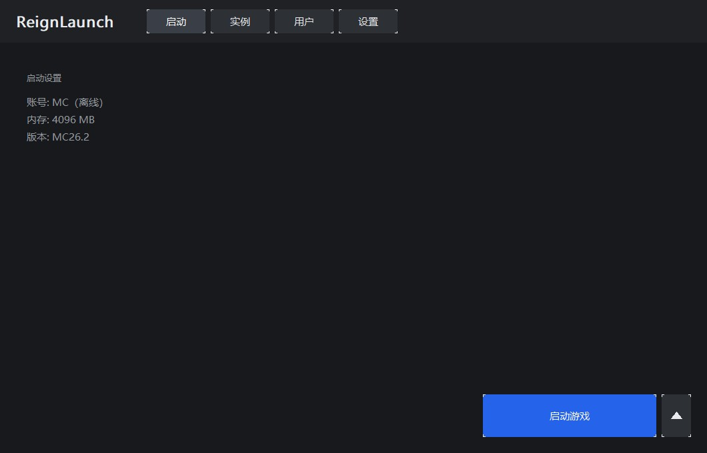
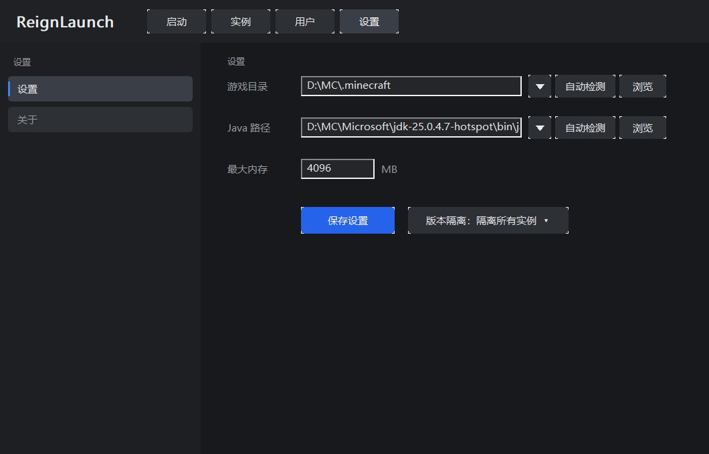
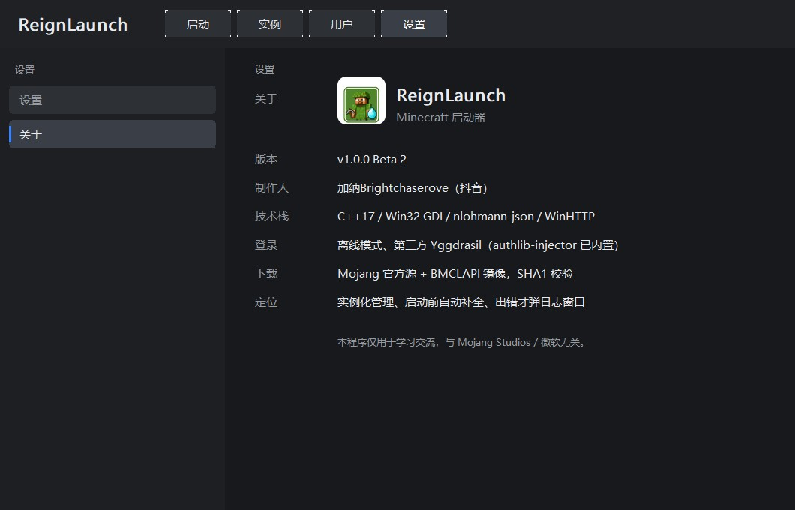

# ReignLaunch

用 **C++17 + Win32 GDI** 从零手写的 Minecraft 启动器，无第三方 UI 框架，单窗口多页面。

**v1.0.0 Beta 3** · 制作人：加纳Brightchaserove（抖音）



---

## 功能

### 实例管理
- 扫描 `.minecraft/versions` 下的全部实例，按名称排序，自动跳过 JSON 缺失的残缺目录
- 侧栏「实例」列表，右侧显示当前实例、账号、内存、Java

### 启动链路
- **版本 JSON 解析**：`inheritsFrom` 递归合并（libraries 追加、arguments 分段合并）
- **规则判定**：`os.name` / `os.arch` / `features`，正确过滤 macOS 专用参数与 demo 参数
- **classpath 构建**：优先 `downloads.artifact.path`，回退 Maven 坐标推算
- **natives**：老版本 classifier 解压（走系统自带 `tar.exe`）
- **占位符替换**：`${natives_directory}` / `${classpath}` / `${library_directory}` 等，未解析的自动丢弃
- **启动前自动补全**：扫描 libraries / 客户端 jar / assets，缺文件先下载再启动
- 用 `java.exe` + `CREATE_NO_WINDOW` 启动：**不弹黑窗口**，但能抓到完整日志

### 账号
- 用户页左侧账户卡片：皮肤头像 + 名字 + 登录方式
- **更换皮肤**：选 64x64 / 64x32 的 PNG，自动存到 `%APPDATA%\ReignLaunch\skins\` 并写入
  `.minecraft\CustomSkinLoader\LocalSkin\textures\<玩家名>.png`（装了 CustomSkinLoader 就能在游戏里看到）
- **离线模式**：UUID = `MD5("OfflinePlayer:名字")` + version 3 / variant 位，与官方一致
- **第三方登录**：标准 Yggdrasil（`POST {server}/authserver/authenticate`），自动注入
  `-javaagent:authlib-injector.jar=<服务器>`（jar 已编译进 exe，运行时不需外部文件）

### 下载器
- WinHTTP 实现，无第三方网络库
- SHA1 校验（已有文件损坏会自动重下）
- `.part` 原子写入，断网不留半截文件
- 官方源失败自动切 **BMCLAPI 镜像**

### 界面
- 四个页面：启动 / 实例 / 用户 / 设置，全部在主窗口内切换，无弹窗式设置；「关于」在设置页左侧子菜单里
- 游戏目录与 Java 路径支持 **▾ 浮层列表**：Java 条目带版本号（读 JDK 的 `release` 文件，不启动 java.exe）
- 进度条：`正在补全文件 120 / 345`、`正在启动游戏…`
- 日志默认不显示，**只有游戏出错才弹独立错误窗口**（带复制日志按钮）

| 设置 | 关于 |
|---|---|
|  |  |

## 构建

需要 **MinGW-w64 GCC 8+**（在 GCC 16.2.0 上验证），以及 `windres`。

1. 下载 [authlib-injector](https://github.com/yushijinhun/authlib-injector/releases) 的 jar，放到 `src/` 并命名为 `authlib-injector.jar`
   （它会被编译进 exe，不随仓库分发）
2. 编译：

```bat
cd src
windres res.rc -O coff -o res.o
g++ -std=c++17 -O2 -mwindows -static ^
    -finput-charset=UTF-8 -fexec-charset=UTF-8 -fwide-exec-charset=UTF-16LE ^
    -o ReignLaunch.exe ReignLaunch.cpp res.o ^
    -lcomctl32 -lole32 -lshell32 -lgdi32 -luuid -ladvapi32 -lwinhttp -lshlwapi -lcomdlg32
```

> `-fwide-exec-charset=UTF-16LE` 不能省，否则宽字符中文会编成 UTF-32，界面全是乱码。

也可以直接跑仓库根目录的 `build.bat`。

## 使用

1. 打开「设置」，点「游戏目录」右侧的 **▾** 选一个 `.minecraft`，或手动浏览指定
2. Java 路径同理，▾ 里会列出所有检测到的运行时和版本号
3. 回「启动」页选实例，点「启动游戏」

配置保存在 `%APPDATA%\ReignLaunch\config.json`（首次运行会自动从旧的 `%APPDATA%\MCLite` 迁移）；
若 exe 同目录存在 `config.json` 则优先使用（便携模式）。

### 命令行

```bat
ReignLaunch.exe --dump 1.20.1-Forge
```

只生成启动命令行到 `dump.txt`，不启动游戏 —— 用来排查参数问题。

## 已知限制

- 下载是单线程串行，没有断点续传
- 没有版本隔离（多实例共用同一份 `.minecraft/mods`）
- 第三方登录不做 token 自动续期，过期需重新登录
- 微软正版登录未实现

## 许可

MIT。第三方组件：`json.hpp`（MIT, nlohmann）、`authlib-injector`（构建时自行提供）。
